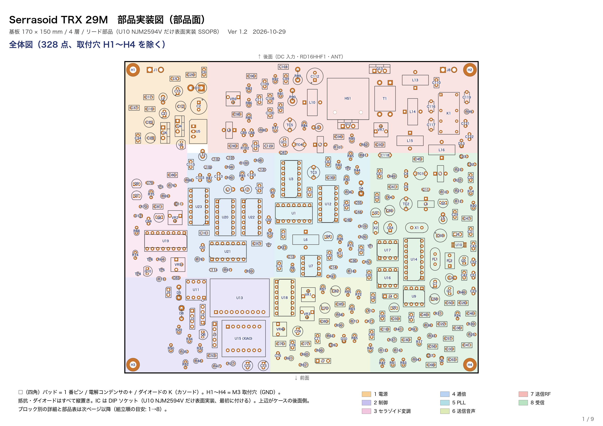

# Serrasoid TRX 29M

29MHz 帯 FM トランシーバ（出力 10W）。送信の変調に、1940 年代後半の放送用 FM 送信機で使われた**セラゾイド変調（Serrasoid）**を汎用 IC で再現する。

> 部品はすべてリード部品（表面実装部品なし）。

> **状態: 回路図 Ver 1.0 作成済み**（[回路図 PDF](kicad/Serrasoid_TRX_回路図.pdf)・[部品表](kicad/BOM.md)・[購入用部品表](kicad/bom_purchase.csv)）。基板 Ver 1.0 は配置・配線まで（DRC エラー 0、[基板チェック](docs/基板チェック.md)、[部品実装図](docs/Serrasoid_TRX_部品実装図.pdf)・[部品配置図 A3](kicad/Serrasoid_TRX_部品配置図.pdf)）。製造データ・ファームウェアはこれから。実機未製作

回路図は 1 枚（A1）。機能ブロック（電源・制御・セラゾイド変調・逓倍・送信音声・送信RF・受信）ごとに枠で囲み、ブロックの中もブロックの間も、信号・電源ともすべて線で結線している（ネットラベルは使わない）。電源の名前（+13V8・+5VT・TX8V など）は、その電源の出どころ（レギュレータの出力など）に電源記号を 1 つ置いて示す。GND だけは GND 記号でつなぐ。

## セラゾイド変調のしくみ

1. 基準信号でのこぎり波（serrated）を作る
2. のこぎり波をコンパレータで「バイアス＋音声電圧」と比べる
3. 音声電圧で交差のタイミングが前後する → パルス位置変調 ＝ 位相変調（PM）
4. 音声をあらかじめ積分（1/f）しておけば PM が FM になる
5. 1 段の偏移は小さいので逓倍して目的の周波数・偏移にする

この機械では**積分器を入れず PM のまま**送信する。アマチュア無線の FM 機は送信で 6dB/oct のプリエンファシス（×f）をかけるのが標準で、「積分（1/f）× プリエンファシス（×f）」は打ち消し合って PM と同じになるため。市販の FM 機（受信側でディエンファシス）で自然な音になる。

## 全体構成

```
                    XIAO ESP32C3（チャンネル・PTT・表示）
                         │ I2C
                       Si5351
             CLK0: 9.15625MHz          CLK1: 18.600MHz（受信局発 = 29.300 − 10.7）
                  │                         │
【送信】          ↓                          │
 マイク → IDC・LPF → セラゾイド変調（915.625kHz）│
                  ↓                         │
            XOR 逓倍 ×32 → 29.300MHz         │
                  ↓                         │
       BPF → 2N3866 → RD06HHF1 → RD16HHF1（10W）→ 7 次 LPF → 送受切替リレー → ANT
                                                              │
【受信】                                                       ↓
 BPF → 2N3819（RF 増幅）→ SA612（混合）←── CLK1
            ↓ 10.7MHz
   10.7MHz 水晶フィルタ（15kHz 幅）→ MC3361（455kHz・検波・スケルチ）→ LM386 → SP
```

## 主な仕様（目標）

| 項目 | 値 |
|---|---|
| 周波数 | 29.000〜29.700MHz（10kHz ステップ、呼出 29.300MHz） |
| 電波型式 | F3E（FM） |
| 送信出力 | 10W（13.8V） |
| 最大周波数偏移 | ±5kHz |
| 変調方式 | セラゾイド変調（915.625kHz で PM）→ ×32 逓倍（プリエンファシス付き FM と同等） |
| 受信方式 | シングルスーパー＋MC3361 内の第 2 変換（10.7MHz / 455kHz） |
| 制御 | Seeed Studio XIAO ESP32C3 ＋ Si5351A |
| 電源 | DC 13.8V（送信時 約 2.5A） |

## 送信部

### セラゾイド変調

| ブロック | 部品 | 内容 |
|---|---|---|
| 基準 | Si5351 CLK0 9.15625MHz → 74HC4017 ÷10 | Q0 が 1.09µs ごとに約 110ns 幅のリセットパルス（グリッチなし） |
| のこぎり波 | 2SA1015 定電流源（約 300µA）＋ 100pF（C0G）、2N7000 で放電 | 傾き約 3V/µs。直線性がそのまま変調の直線性になる |
| 比較 | MAX913CPA（10ns、DIP-8、単電源 5V。LE は GND でラッチなし） | ＋入力にのこぎり波、−入力にしきい値（中心は半固定 VR で調整 ± 音声） |
| パルス整形 | 74HCT123（MAX913 の TTL 出力を受けるため HCT 品） | 立ち上がりでトリガ、デューティ 50% に調整 |
| 音声 | MCP6004：マイクアンプ → 利得段 → IDC（±0.6V クリップ）→ 3kHz LPF → しきい値バッファ | 偏移は半固定 VR で ±5kHz に合わせる |

チャンネル変更は CLK0 を変えるだけ（出力 10kHz ステップ = CLK0 3.125kHz ステップ）。

### 逓倍 ×32

| 段 | 出力 | 部品 |
|---|---|---|
| 1〜4 | 1.83 → 3.66 → 7.33 → 14.65MHz | 74AC86（1 個目） |
| 5 | 29.30MHz ＋ 出力バッファ | 74AC86（2 個目） |

各段は XOR（x, RC で遅らせて 74AC14 で整形した x）。遅延（RC ＋ 74AC14）は入力周期の 1/4（273 → 137 → 68 → 34 → 17ns）で、出力のデューティが 50% になる。RC のなまった波形を直接 74AC86 に入れないよう、シュミットの 74AC14 を通す。逓倍後に 29MHz の複同調 BPF。

偏移: PM なので変調周波数に比例する。3kHz で ±5kHz のとき、変調部での位相は ±0.052rad（しきい値で ±27mV 程度）。変調部の電源は DC-DC ではなくリニアレギュレータ（L7805、+5VT）にして、リプルが位相雑音にならないようにしている。

### 電力増幅（13.8V）

| 段 | 部品 | 出力 |
|---|---|---|
| バッファ | 2N3866（TO-39、TX8V・約 40mA） | 約 30mW |
| ドライバ | RD06HHF1 | 約 0.5〜1W |
| ファイナル | RD16HHF1 | 10W |

出力は BN43-202 の 1:6.25 トランス（一次 2 回・二次 5 回、ドレイン負荷 約 8Ω）→ 7 次チェビシェフ LPF（fc 約 32MHz）→ 出力検出（容量分割 ＋ 1N60、XIAO の A1 へ）。

## 受信部

| ブロック | 部品 |
|---|---|
| RF | 29MHz 複同調 BPF（T-30-6 タップ付き）→ 2N3819（ソース接地、ドレインはチョーク給電） |
| 第 1 混合 | SA612（局発 Si5351 CLK1） |
| 第 1 IF | 10.7MHz 水晶フィルタ（10M15A 相当） |
| 第 2 IF・検波 | MC3361（10.245MHz 水晶、455kHz セラミックフィルタ、CDBM455 ディスクリミネータ） |
| スケルチ | ノイズ（7kHz 以上）を MCP6002 で増幅・検波して XIAO の A2 へ。XIAO が LM386 入力をミュート |
| AF | LM386（約 0.5W） |

## 制御部

- XIAO ESP32C3：ロータリーエンコーダでチャンネル選択、PTT、送受切替リレー、スケルチ、出力表示、表示器（TJC、I2C の OLED も可）
- 送受切替は G5V-2 1 個: 1 極目でアンテナ、2 極目で 8V を RX8V / TX8V に振り分ける（送信系のバイアスは TX8V のときだけかかる）

| XIAO | 用途 | XIAO | 用途 |
|---|---|---|---|
| D0 | PTT 入力（起動設定ピン） | D6 | 表示器 TX |
| D1/A1 | 出力検出 | D7 | ミュート出力 |
| D2/A2 | スケルチ用ノイズ | D8 | エンコーダ B |
| D3 | エンコーダ A | D9 | エンコーダ SW（起動設定ピン） |
| D4/D5 | I2C（Si5351） | D10 | 送信（リレー）出力 |

ESP32-C3 は電源投入時に GPIO2（D0）と GPIO9（D9）が High のときフラッシュから起動するので、この 2 本にはふだん開放の PTT とエンコーダ SW をつないでいる。PTT やつまみを押したまま電源を入れないこと。
- 送信時は CLK0（変調基準）、受信時は CLK1（局発）。受信中は CLK0 を止めて自局の回り込みを防ぐ

## 電源

| 電源 | 作り方 | 主な使い先 |
|---|---|---|
| +13V8 | DC 入力（逆接続は 1N5408 でヒューズを切る） | RD06HHF1・RD16HHF1 のドレイン、リレー |
| +5V | R-78E5.0-1.0（DC-DC） | XIAO・表示器 |
| +8V | L7808 | リレー 2 極目経由で RX8V / TX8V |
| +5VT | L7805（+8V から） | セラゾイド変調・逓倍・送信音声 |
| +5VA | 78L05（RX8V から） | SA612・MC3361・スケルチ |
| +3V3S | LP2950-3.3 | Si5351 モジュール |

論理チェックの結果は [docs/回路図論理チェック.md](docs/回路図論理チェック.md)。

## 再生成のしかた

```
python3 tools/mklib.py     # 記号・フットプリントのライブラリ
python3 tools/gen_sch.py   # 回路図（部品配置と結線を自動で行う）
python3 tools/gen_bom.py   # 部品表
# 基板（KiCad 付属の Python で配置、Freerouting 1.9.0 で配線。jar は ~/tools/freerouting-1.9.jar、別の場所なら FREEROUTING= で指定）
/Applications/KiCad/KiCad.app/Contents/Frameworks/Python.framework/Versions/Current/bin/python3 tools/gen_pcb.py
tools/route.sh
tools/check.sh             # 回路図を作り直して ERC と接続照合（tools/verify_sch.py）
```

回路図での部品の位置は `tools/circuit.py` の `LAYOUT` で手で決めてある（ない部品は自動で置く）。KiCad で部品を動かしたときは `python3 tools/import_layout.py` で位置を `LAYOUT` に取り込める。回路を直すときは `tools/circuit.py` を編集して作り直す（KiCad で回路図を直接直した場合は、circuit.py にも同じ修正を入れる）。

## 運用上の注意

- 29MHz 帯 FM は 4 級でも 10W まで運用可。自作機のため保証認定（JARD / TSS）と変更申請が必要
- 逓倍方式は分数調波・隣の逓倍成分が出やすい。スペクトラムアナライザでスプリアスが規格内か確認すること（特に 14.65MHz・43.95MHz 付近）
- 周波数は JARL バンドプランの FM 区分に合わせる

## 基板の組み立て

[部品実装図（PDF、8 ページ）](docs/Serrasoid_TRX_部品実装図.pdf): 1 ページ目が全体図、2 ページ目からブロックごと（電源 → 制御 → セラゾイド変調 → 逓倍 → 送信音声 → 送信RF → 受信、組立順の目安）に、そのブロックの部品を強調した図と部品表（値・種類・極性などの注意）。A3 1 枚の配置図は [kicad/Serrasoid_TRX_部品配置図.pdf](kicad/Serrasoid_TRX_部品配置図.pdf)。



作り直し: `docs/tools/export_board.py`（KiCad 付属の Python で基板を JSON に）→ `docs/tools/make_parts_layout.py`（部品表は `tools/circuit.py` から）、A3 は `docs/tools/make_layout_a3.sh`。

## フォルダ

| フォルダ | 内容 |
|---|---|
| `kicad/` | 回路図・部品表・基板（KiCad 10）。部品番号は回路図の位置順（X の小さい順、同じ X は Y の順。2026-10-16 に振り直し、新旧の対応は `kicad/refdes_map_2026-10-16.csv`） |
| `tools/` | 回路図・部品表を作るスクリプト（回路は `tools/circuit.py` にまとめてある） |
| `firmware/` | XIAO ESP32C3 スケッチ |
| `docs/` | 資料 |
| `enclosure/` | ケース（OpenSCAD、3D 印刷用 STL・パネル穴あけ図、[説明](enclosure/README.md)） |

## ライセンス

GPL-3.0（[LICENSE](LICENSE)）

Designed by JA6FUF
