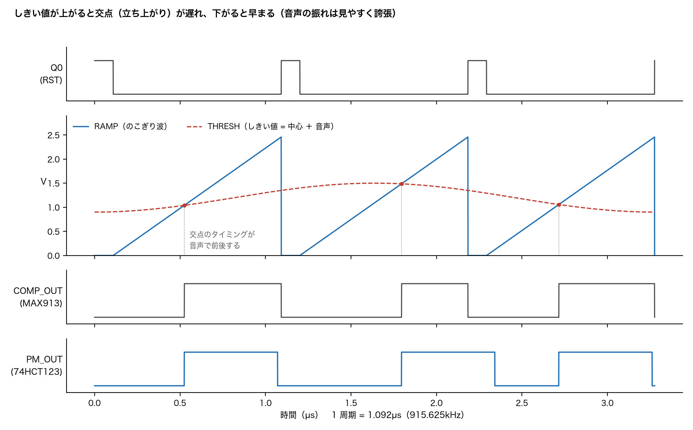
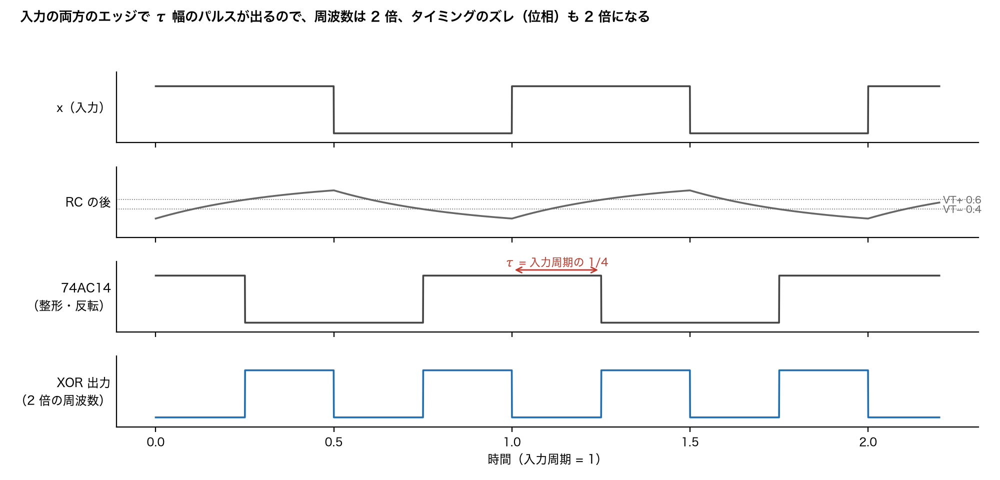

# Serrasoid TRX 29M

29MHz 帯 FM トランシーバ（出力 10W）。送信の変調に、1940 年代後半の放送用 FM 送信機で使われた**セラゾイド変調（Serrasoid）**を汎用 IC で再現する。

> 部品はリード部品（第 1 混合の NJM2594V だけ表面実装 SSOP8。SA612 が製造中止のため）。

> **状態: 回路図 Ver 1.2 作成済み**（[回路図 PDF](kicad/Serrasoid_TRX_回路図.pdf)・[部品表](kicad/BOM.md)・[購入用部品表](kicad/bom_purchase.csv)）。基板 Ver 1.2（170 × 150mm）は配置・配線まで（スプリアス対策で逓倍を ×16 にし段間同調と PLL を追加、DRC エラー 0、[基板チェック](docs/基板チェック.md)、[部品実装図](docs/Serrasoid_TRX_部品実装図.pdf)・[部品配置図 A3](kicad/Serrasoid_TRX_部品配置図.pdf)）。スケッチ（[firmware/Serrasoid_TRX](firmware/Serrasoid_TRX/)、コンパイル確認のみ）・LCD 画面の背景と作り方は作成済み、製造データ（ガーバー）は出力済み（[kicad/production](kicad/production/)）、LCD の画面データ（.HMI）はこれから。実機未製作

回路図は 1 枚（A0）。機能ブロック（電源・制御・セラゾイド変調・逓倍・PLL・送信音声・送信RF・受信）ごとに枠で囲み、ブロックの中もブロックの間も、信号・電源ともすべて線で結線している（ネットラベルは使わない）。電源の名前（+13V8・+5VT・TX8V など）は、その電源の出どころ（レギュレータの出力など）に電源記号を 1 つ置いて示す。GND だけは GND 記号でつなぐ。

## 動作原理

### 1. セラゾイド変調（位相変調を作る）

セラゾイド（Serrasoid）は「のこぎり波（serrated）」から来た名前で、のこぎり波としきい値の交点のタイミングで位相を変える方式です。



1. **基準クロック**: Si5351 の CLK0 から 1.83125MHz（周期 546ns）を直接出し、その立ち上がりで 74HCT123 の 2 回路目が幅 約 50〜100ns のリセットパルスを作ります。
2. **のこぎり波**: 2SA1015 の定電流源（約 300µA）で 68pF を充電すると、電圧は時間に比例して上がります（傾き 約 3.4V/µs）。リセットパルスで 2N7000 が放電し、1 周期ごとに 0V に戻ります。
3. **比較**: 2SA1015 2 個の差動対（Q9・Q10、電流 約 2.3mA）が、のこぎり波と「しきい値 = 直流の中心（約 0.85V）＋ 音声」を比べます。のこぎり波がしきい値を超えると、Q9 が切れて出力 COMP_N が約 2.3V から 0V に下がります。しきい値が ΔV 上がると、交点は Δt ＝ ΔV ÷（傾き）だけ遅れます。傾きが一定なので、**タイミングのずれ（＝位相のずれ）が音声電圧に比例**します。
4. **パルス整形**: 74HCT123 の 1 回路目が交点（COMP_N の立ち下がり）で幅 273ns（デューティ 50%）のパルスを出します。この方形波 PM_OUT の両方のエッジが音声で前後する、位相変調（PM）された 1.83125MHz です。

位相のずれは Δφ ＝ 2π × Δt ÷ T（T ＝ 546ns）。たとえばしきい値が 1mV 動くと Δt ≒ 0.29ns、Δφ ≒ 3.4mrad です。

### 2. PM と FM の関係（積分器を入れない理由）

位相を φ(t) ＝ β sin(2π fm t) と動かすと、周波数は f ＝ (1/2π) dφ/dt だけずれるので、偏移は Δf ＝ β × fm になります。PM では同じ大きさの音なら β が一定なので、**偏移は音の高さに比例**（6dB/oct で増える）します。

放送用のセラゾイド送信機は、音声を先に積分（1/f）して PM を FM に直していました。アマチュア無線の FM 機は、送信で 6dB/oct のプリエンファシス（×f）をかけ、受信でディエンファシスで戻すのが標準です。「積分（1/f）× プリエンファシス（×f）」は打ち消し合うので、**積分器を入れずに PM のまま送れば、プリエンファシス付き FM と同じ**になり、市販の FM 機で自然な音で聞こえます。

### 3. 逓倍（周波数も位相も 16 倍に）



変調部での位相のずれは小さい（3kHz で ±5kHz に必要な ±1.67rad の 1/16、±0.104rad）ので、逓倍して周波数と偏移を同時に上げます。

- **XOR 逓倍**: 入力 x と、x を入力周期の 1/4 だけ遅らせたもの（RC ＋ 74AC14）を XOR に入れると、入力の両方のエッジで幅 1/4 周期のパルスが出て、周波数が 2 倍になります。これを 4 段重ねて 1.83 → 3.66 → 7.33 → 14.65 → 29.30MHz（×16）。
- **位相も 16 倍**: 逓倍はエッジのタイミングのずれ Δt をそのまま運び、周期が 1/2 になるごとに同じ Δt が 2 倍の位相になります。29.3MHz での位相のずれは 16 × Δφ、偏移は Δf ＝ 16 × Δφ × fm です。
- **段間同調**: 遅延が 1/4 周期からずれる（74AC14 のしきい値や部品のばらつきで数 ns）と、出力のデューティがくずれて入力周波数の成分（分数調波）が残り、次の段がそれを運んで基準周波数おきの側帯波（スプリアス）になります。そこで段 1〜3 の出力を LC の並列共振（Q 約 5）で正弦波にし、自己バイアスの 74HCU04 で**平均値を境に矩形へ戻す**ことで、デューティを 50% にそろえます（分数調波 約 −16dB）。

### 4. PLL 追従フィルタ（スプリアスを落とす）

×16 の出力にはまだ ±1.83MHz おきの側帯波（計算で −11dBc 程度）が残ります。29.3MHz の VCO をこの信号に位相同期させ、VCO の出力を送信に使います。

- **位相周波数比較**: 74AC74 の 2 個の D-FF を ×16 の出力と VCO でそれぞれセットし、両方 High になったら 74AC00 で両方クリアします。進んでいる側に、位相差に比例した幅のパルスが出ます（周波数が違っても正しい向きに引き込む）。
- **ループフィルタ**: MCP6002 の差動積分器で UP − DN を積分し、VCO の制御電圧 VT（0〜5V）を作ります。ループ帯域 約 37kHz、ζ ≒ 0.7。
- **VCO**: 74HCU04 のピアース（コルピッツ）型 LC 発振。1N4007 の接合容量を可変容量に使い、VT で約 0.8MHz 動かします。
- **効き方**: PLL はループ帯域より遅い位相の動きにだけ追従します。音声の位相変調（〜3kHz）はそのまま VCO に移り、±1.83MHz の側帯波は VCO に移りません（約 −77dB）。計算では、送信 BPF・LPF と合わせてアンテナ端の側帯波は最悪 −99dBc です（[図](docs/images/spurious_calc_0-300MHz.png)）。

### 5. 電力増幅

VCO の出力（3 回路を 330Ω ずつで合成）→ 送信 BPF（29MHz 複同調、1pF 結合）→ 2N2222A（バッファ）→ IRF510（ドライバ、約 0.3W）→ MRF101AN（ファイナル、10W）。MRF101AN は NXP の LDMOS（TO-220、定格 50V）で、13.8V でも 29MHz で 17dB 前後の利得があり、ドライバは 0.2〜0.3W で足ります（2026-10-29 に製造終了の RD06HHF1・RD16HHF1 から変更）。13.8V で 10W を出すにはドレイン負荷 約 8Ω が要るので、BN43-202 の 1:6.25 トランス（一次 2 回・二次 5 回）で 50Ω に合わせ、7 次チェビシェフ LPF（fc 約 32MHz）で高調波を落とします。出力の一部を容量分割 ＋ 1N60 で検波し、XIAO が送信出力を表示します。

### 6. 受信（ダブルスーパー）

1. **RF**: 29MHz 複同調 BPF → 2N3819（ソース接地）で増幅。
2. **第 1 混合**: NJM2594V（ダブルバランスドミキサ）で、Si5351 の CLK1（受信周波数 − 10.7MHz、29.3MHz なら 18.6MHz）と混ぜて 10.7MHz に。変換利得が 0dB なので、2SC1815 で約 19dB 増幅します。
3. **第 1 IF**: 10.7MHz 水晶フィルタ（帯域 15kHz）で隣のチャンネルを落とします。
4. **第 2 IF・検波**: MC3361 の中で 10.245MHz の水晶発振と混ぜて 455kHz にし、セラミックフィルタ → リミッタ → クオドラチャ検波（CDBM455 ディスクリミネータ）で音声に戻します。
5. **低周波**: ディエンファシス（470µs）→ VOL → LM386（約 0.5W）。

### 7. スケルチと S メーター

- **ノイズスケルチ**: FM は信号が強いほど、検波出力の高い周波数のノイズが減ります（クワイティング）。検波出力の 7kHz 以上を MCP6002 で約 47 倍に増幅して倍電圧検波し、その電圧を XIAO が読みます。電圧が設定（SQL 1〜9）より下がると信号ありと判断し、Q4 で LM386 の入力を GND から離して音を出します。
- **S メーター**: MC3361 には受信電界強度（RSSI）の出力がないので、10.7MHz 水晶フィルタの後ろを 2.2kΩ で取り出し、2SC1815 の同調増幅（約 26dB）→ AD8307 で測ります。AD8307 は対数増幅器で、入力電力 1dB ごとに出力が 25mV 変わります。これを ADS1115（I2C の 16 ビット ADC）で読み、S 単位（6dB ＝ S1 つ）に直してアナログメーターに表示します。

### 8. 周波数の決め方と送受切替

| | 計算 | 29.300MHz のとき |
|---|---|---|
| 送信 CLK0 | 送信周波数 ÷ 16 | 1.83125MHz（×16 で 29.3MHz） |
| 受信 CLK1 | 受信周波数 − 10.7MHz | 18.600MHz |

- チャンネルは Si5351 の設定を変えるだけです（出力 10kHz ＝ CLK0 625Hz）。PLL は ×16 の出力に追従します。
- **送受切替**: PTT を押すと、XIAO が CLK1 を止め → リレー G5V-2 を切り替え（1 極目でアンテナ、2 極目で 8V を TX8V へ）→ 15ms 待って CLK0 を出します。送信系のバイアスは TX8V のときだけかかります。受信中は CLK0 を止め、VCO の入力も 2SC1815 で GND に落とすので、自局の信号が受信に回り込みません。
- **スキャン**: 10kHz ずつ周波数を変え、1 チャンネル 200ms ずつスケルチの電圧を見て、信号があれば止まります。

## 全体構成

```
                    XIAO ESP32C3（チャンネル・PTT・表示）
                         │ I2C
                       Si5351
             CLK0: 1.83125MHz          CLK1: 18.600MHz（受信局発 = 29.300 − 10.7）
                  │                         │
【送信】          ↓                          │
 マイク → IDC・LPF → セラゾイド変調（1.83125MHz）│
                  ↓                         │
  XOR 逓倍 ×16（段間同調）→ PLL（VCO）→ 29.300MHz│
                  ↓                         │
       BPF → 2N2222A → IRF510 → MRF101AN（10W）→ 7 次 LPF → 送受切替リレー → ANT
                                                              │
【受信】                                                       ↓
 BPF → 2N3819（RF 増幅）→ NJM2594（混合）←── CLK1
            ↓ 10.7MHz 増幅（2SC1815）
   10.7MHz 水晶フィルタ（15kHz 幅）→ MC3361（455kHz・検波・スケルチ）→ LM386 → SP
```

## 仕様

数値は設計値・計算値です（実機は未製作で、測定はしていません）。

### 送信

| 項目 | 値 |
|---|---|
| 周波数 | 29.000〜29.700MHz（呼出 29.300MHz）。ステップ 1k・5k・10k・100kHz（既定 10kHz） |
| 電波型式 | F3E（FM） |
| 送信出力 | 10W（13.8V、50Ω） |
| 最大周波数偏移 | ±5kHz（3kHz の音で。半固定 VR で合わせる） |
| 変調方式 | セラゾイド変調（1.83125MHz で PM）→ XOR 逓倍 ×16（段間同調つき）→ PLL 追従フィルタ（VCO 29.3MHz）。積分器なしの PM ＝ 6dB/oct のプリエンファシス付き FM と同じ特性 |
| 音声 | エレクトレットマイク、IDC（±0.6V クリップ）、3kHz LPF |
| 電力増幅 | 2N2222A（バッファ）→ IRF510（ドライバ）→ MRF101AN（ファイナル）→ BN43-202 で 1:6.25 → 7 次チェビシェフ LPF（fc 約 32MHz） |
| スプリアス（計算） | 逓倍のずれによる側帯波 最悪 −99dBc（部品のばらつき 200 通り）、2 倍の高調波 −72dBc（PA の高調波は仮定）。[図](docs/images/spurious_calc_0-300MHz.png)。規格は 50mW 以下かつ −50dBc |
| 送信の切り替え | PTT → リレー（G5V-2）→ 15ms 後に変調基準を出す。29.000〜29.700MHz の外では送信しない |

### 受信

| 項目 | 値 |
|---|---|
| 方式 | ダブルスーパー（第 1 IF 10.7MHz、第 2 IF 455kHz。第 2 変換以降は MC3361） |
| RF | 29MHz 複同調 BPF → 2N3819（ソース接地） |
| 第 1 混合・局発 | NJM2594V（DBM）、局発は Si5351 の CLK1（受信周波数 − 10.7MHz、下側） |
| 選択度 | 10.7MHz 水晶フィルタ（帯域 15kHz）＋ 455kHz セラミックフィルタ |
| 復調 | MC3361（クオドラチャ検波、CDBM455 ディスクリミネータ）、ディエンファシス 470µs |
| 低周波出力 | LM386 約 0.5W（8Ω、内蔵スピーカー 5cm または外部スピーカー） |
| スケルチ | ノイズスケルチ（7kHz 以上のノイズを検波、XIAO が判定してミュート）。深さ SQL 0〜9 |
| S メーター | AD8307（対数増幅）で 10.7MHz 水晶フィルタの後ろの強さを測る。計算で S2〜S9＋40 程度。アナログメーター表示 |
| スキャン | 29.000〜29.700MHz を 10kHz ずつ。スケルチが開いたら止まり、信号が消えて 3 秒で再開 |

### 制御・表示

| 項目 | 値 |
|---|---|
| マイコン | Seeed Studio XIAO ESP32C3（スケッチ: [firmware/Serrasoid_TRX](firmware/Serrasoid_TRX/)） |
| 発振 | Si5351A モジュール（秋月 AE-Si5351A）。CLK0 = 変調基準（送信周波数 ÷ 16）、CLK1 = 受信局発 |
| 表示器 | Nextion NX4832T035（3.5 インチ 480 × 320、PSN_TRX と同じ）。TJC4832T135 も可。周波数・ステップ・アナログ S メーター（送信中は出力 W）・RX / TX / SCAN・スケルチ・BUSY |
| 操作 | 上面 TUNE（ロータリーエンコーダ、押す・長押し）、VOL、POWER、MIC（PTT 付き）、EXT SP |
| 記憶 | 周波数・ステップ・スケルチを XIAO のフラッシュに保存 |

### 電源・外形

| 項目 | 値 |
|---|---|
| 電源 | DC 13.8V（送信時 約 2.5A、受信時 約 0.3A の目安）。ヒューズ 5A、逆接続は 1N5408（1N5822）でヒューズを切る |
| 基板 | 170 × 150mm、4 層（内層 2 枚は GND）、部品 327 点（表面実装は NJM2594V の 1 点だけ）、Ver 1.2 |
| ケース | 200 × 175 × 50mm（3D 印刷、OpenSCAD）。終段の放熱器のフィンを後面の窓から外に出す |

## 送信部

### セラゾイド変調

| ブロック | 部品 | 内容 |
|---|---|---|
| 基準 | Si5351 CLK0 1.83125MHz → 74HCT123（2 回路目） | CLK0 の立ち上がりで約 50〜100ns 幅のリセットパルス |
| のこぎり波 | 2SA1015 定電流源（約 300µA）＋ 68pF（C0G）、2N7000 で放電 | 傾き約 3.4V/µs（山 約 1.7V）。直線性がそのまま変調の直線性になる |
| 比較 | 2SA1015 × 2 の差動対（電流 約 2.3mA、負荷 1kΩ） | 片方にのこぎり波、もう片方にしきい値（中心は半固定 VR で調整 ± 音声）。遅れは一定なので位相のずれにならない |
| パルス整形 | 74HCT123（1 回路目。Si5351 の 3.3V を受けるため HCT 品） | 比較出力の立ち下がりでトリガ、約 273ns（デューティ 50%）に調整 |
| 音声 | MCP6004：マイクアンプ → 利得段 → IDC（±0.6V クリップ）→ 3kHz LPF → しきい値バッファ | 偏移は半固定 VR で ±5kHz に合わせる |

チャンネル変更は CLK0 を変えるだけ（出力 10kHz ステップ = CLK0 625Hz ステップ。29.000〜29.700MHz は CLK0 1.8125〜1.85625MHz）。PLL は ×16 の出力に追従する。

### 逓倍 ×16・段間同調・PLL

| 段 | 出力 | 部品 |
|---|---|---|
| ×2 段 1〜4 | 1.83 → 3.66 → 7.33 → 14.65 → 29.30MHz | 74AC86、遅延の整形 74AC14 |
| 段間同調 1〜3 | 3.66 / 7.33 / 14.65MHz を正弦波にして矩形に戻す | 1k（段 3 は 470Ω）＋ LC 並列共振（10µH・180p / 4.7µH・100p / 1µH・120p、Q 約 5、調整なし）→ 74HCU04（自己バイアス）→ 74AC14 |
| PLL | 29.30MHz の VCO を ×16 の出力に位相同期 | 74AC74（位相周波数比較）・74AC00・MCP6002（ループフィルタ）・VCO 専用の 74HCU04 の LC 発振（1N4007 を可変容量に） |

各段は XOR（x, RC で遅らせて 74AC14 で整形した x）。遅延（RC ＋ 74AC14）は入力周期の 1/4（137 → 68 → 34 → 17ns）で、出力のデューティが 50% になる。RC のなまった波形を直接 74AC86 に入れないよう、シュミットの 74AC14 を通す。

**スプリアス対策（2026-10-29、Ver 1.2）**: XOR 逓倍は、各段の遅延が 1/4 周期からずれる（74AC14 のしきい値・部品のばらつきで数 ns）と、デューティがくずれて基準周波数（F0）おきの側帯波が出る。Ver 1.1（915.625kHz × 32、段間に同調なし）は計算でアンテナ端 −13dBc 程度、ばらつき込みでは搬送波並みになり、規格（30MHz 以下: 50mW 以下かつ −50dBc）を満たさなかった。2 段の複同調 BPF も 2pF 結合で過結合になっていて、±0.92MHz では数 dB しか落ちない。そこで次の 3 つを入れた。

1. **逓倍数を減らす**: 変調を 1.83125MHz（Si5351 の CLK0 から直接）で行い ×16 に。側帯波の間隔が 1.83MHz に広がり、BPF・PLL で落としやすくなる
2. **段間同調**: 段 1〜3 の出力を LC で正弦波にし、平均値を境に矩形へ戻す（自己バイアスの 74HCU04）。前の段のデューティのくずれが約 16dB 下がり、×16 の出力でエッジが欠ける（計算では同調なしで 200 台中 160 台）ことがなくなる
3. **PLL 追従フィルタ**: ×16 の出力に 29.3MHz の VCO を位相同期させ、VCO の出力を送信する。ループ帯域は約 37kHz で、音声の位相変調（〜3kHz）はそのまま通り、±1.83MHz の側帯波は約 −77dB になる

あわせて送信 BPF の結合を 2pF → 1pF（29.0〜29.7MHz の偏差 0.6dB 以内）にした。計算（部品のばらつき 200 通り）では、アンテナ端の側帯波は最悪 −99dBc。実機ではスペクトラムアナライザで確認すること。

偏移: PM なので変調周波数に比例する。3kHz で ±5kHz のとき、変調部での位相は ±0.104rad（エッジで ±9ns、しきい値で ±31mV 程度）。変調部の電源は DC-DC ではなくリニアレギュレータ（L7805、+5VT）にして、リプルが位相雑音にならないようにしている。

受信中は VCO の入力を 2SC1815 で GND に落として発振を止める（受信周波数に VCO が漏れないように）。VCO の中心は TC（30p）で合わせる: 29.300MHz で送信し、TP「VT」が約 2.5V になるように回す。

### 電力増幅（13.8V）

| 段 | 部品 | 出力 |
|---|---|---|
| バッファ | 2N2222A（TO-92、TX8V・約 33mA） | 約 30mW |
| ドライバ | IRF510（放熱器 HS1、絶縁して取り付け） | 約 0.3〜0.5W |
| ファイナル | MRF101AN（ケースの放熱器、絶縁不要） | 10W |

出力は BN43-202 の 1:6.25 トランス（一次 2 回・二次 5 回、ドレイン負荷 約 8Ω）→ 7 次チェビシェフ LPF（fc 約 32MHz）→ 出力検出（容量分割 ＋ 1N60、XIAO の A1 へ）。

## 受信部

| ブロック | 部品 |
|---|---|
| RF | 29MHz 複同調 BPF（T-30-6 タップ付き）→ 2N3819（ソース接地、ドレインはチョーク給電） |
| 第 1 混合 | NJM2594V（DBM、表面実装 SSOP8。局発 Si5351 CLK1）→ 10.7MHz 増幅（2SC1815、変換利得 0dB を補う） |
| 第 1 IF | 10.7MHz 水晶フィルタ（10M15A 相当） |
| 第 2 IF・検波 | MC3361（10.245MHz 水晶、455kHz セラミックフィルタ、CDBM455 ディスクリミネータ） |
| スケルチ | ノイズ（7kHz 以上）を MCP6002 で増幅・検波して XIAO の A2 へ。XIAO が LM386 入力をミュート |
| S メーター | 10.7MHz 水晶フィルタの出力を 2.2kΩ で取り出し → 2SC1815 同調増幅（4.7µH・47p、約 26dB）→ AD8307（対数増幅、25mV/dB、DIP-8）→ ADS1115 モジュール（I2C、A0）→ XIAO。計算で S2〜S9＋40 程度（MC3361 に RSSI 出力がないため、2026-10-29 に追加） |
| AF | LM386（約 0.5W） |

## 制御部

- XIAO ESP32C3：ロータリーエンコーダでチャンネル選択、PTT、送受切替リレー、スケルチ、周波数スキャン、表示器（Nextion NX4832T035、PSN_TRX と同じ。TJC4832T135 も可。アナログ S メーター・送信出力計）。スケッチは [firmware/Serrasoid_TRX](firmware/Serrasoid_TRX/)
- 送受切替は G5V-2 1 個: 1 極目でアンテナ、2 極目で 8V を RX8V / TX8V に振り分ける（送信系のバイアスは TX8V のときだけかかる）

| XIAO | 用途 | XIAO | 用途 |
|---|---|---|---|
| D0 | PTT 入力（起動設定ピン） | D6 | 表示器 TX |
| D1/A1 | 出力検出 | D7 | ミュート出力 |
| D2/A2 | スケルチ用ノイズ | D8 | エンコーダ B |
| D3 | エンコーダ A | D9 | エンコーダ SW（起動設定ピン） |
| D4/D5 | I2C（Si5351・ADS1115） | D10 | 送信（リレー）出力 |

ESP32-C3 は電源投入時に GPIO2（D0）と GPIO9（D9）が High のときフラッシュから起動するので、この 2 本にはふだん開放の PTT とエンコーダ SW をつないでいる。PTT やつまみを押したまま電源を入れないこと。
- 送信時は CLK0（変調基準 = 送信周波数 ÷ 16）、受信時は CLK1（局発）。受信中は CLK0 を止めて自局の回り込みを防ぐ（VCO は受信中 RX8V で止まる）

## 電源

| 電源 | 作り方 | 主な使い先 |
|---|---|---|
| +13V8 | DC 入力（逆接続は 1N5408 でヒューズを切る） | IRF510・MRF101AN のドレイン、リレー |
| +5V | R-78E5.0-1.0（DC-DC） | XIAO・表示器 |
| +8V | L7808 | リレー 2 極目経由で RX8V / TX8V |
| +5VT | L7805（+8V から） | セラゾイド変調・逓倍・送信音声 |
| +5VA | 78L05（RX8V から） | NJM2594・MC3361・スケルチ |
| +3V3S | LP2950-3.3 | Si5351 モジュール |

論理チェックの結果は [docs/回路図論理チェック.md](docs/回路図論理チェック.md)。

## 再生成のしかた

```
python3 tools/mklib.py     # 記号・フットプリントのライブラリ
python3 tools/gen_sch.py   # 回路図（部品配置と結線を自動で行う）
python3 tools/gen_bom.py   # 部品表
# 基板（KiCad 付属の Python で配置、Freerouting 1.9.0 で配線。jar は ~/tools/freerouting-1.9.jar、別の場所なら FREEROUTING= で指定）
/Applications/KiCad/KiCad.app/Contents/Frameworks/Python.framework/Versions/Current/bin/python3 tools/gen_pcb.py
tools/route.sh
tools/check.sh             # 回路図を作り直して ERC と接続照合（tools/verify_sch.py）
```

回路図での部品の位置は `tools/circuit.py` の `LAYOUT` で手で決めてある（ない部品は自動で置く）。KiCad で部品を動かしたときは `python3 tools/import_layout.py` で位置を `LAYOUT` に取り込める。回路を直すときは `tools/circuit.py` を編集して作り直す（KiCad で回路図を直接直した場合は、circuit.py にも同じ修正を入れる）。

## 運用上の注意

- 29MHz 帯 FM は 4 級でも 10W まで運用可。自作機のため保証認定（JARD / TSS）と変更申請が必要
- 逓倍方式は分数調波・隣の逓倍成分が出やすい。PLL 追従フィルタで落としているが、スペクトラムアナライザでスプリアスが規格内か確認すること（特に ±1.83MHz（27.47・31.13MHz）、14.65MHz・43.95MHz 付近）。PLL が外れる（TP「VT」が 0V か 5V に張り付く）と VCO が勝手な周波数で出るので、送信前に VT を確認する
- 周波数は JARL バンドプランの FM 区分に合わせる

## 組み立て方

### 1. 部品をそろえる

- [購入用部品表](kicad/bom_purchase.csv)（Excel で開ける）に、部品ごとの購入先・型番・販売コード・入数・価格を載せています。大半は秋月電子、秋月にないものは DigiKey など（2026-10-29 に在庫を調べた結果をメモ欄に記載）。
- **入手に注意する部品**（早めに確保するか、代わりを検討）: MC3361（Motorola 品は製造中止、UTC の互換品あり）、CDBM455C24（製造中止の恐れ）、AD8307ANZ（DigiKey の標準納期 10 週）、2N3819（取り寄せ）。74HCT4017・MAX913・2N3866・RD06HHF1・RD16HHF1 は 2026-10-29 に手に入りやすい部品（74HCT123 の 2 回路目・2SA1015 の差動対・2N2222A・IRF510・MRF101AN）に置き換えました。MRF101AN は DigiKey（568-14751-ND、1 個 約 5,000〜6,000 円）で買えます。
- 基板の外の部品（IC ソケット、パネルのコネクタ、LCD、ねじなど）も購入用部品表の最後にまとめてあります。

### 2. 基板を作る

- 基板データは `kicad/Serrasoid_TRX.kicad_pcb`（KiCad 10、170 × 150mm、4 層）。
- **製造データ**: [kicad/production/Serrasoid_TRX_Gerber_JLCPCB.zip](kicad/production/Serrasoid_TRX_Gerber_JLCPCB.zip)（ガーバー 11 層＋ドリル＋ジョブファイル）をそのまま基板メーカーにアップロードします。発注のときの指定（4 層・1.6mm・最小穴 0.4mm など）は [kicad/production/JLCPCB_提出資料.md](kicad/production/JLCPCB_提出資料.md)。部品の実装は頼まず、手はんだで組み立てます。

### 3. はんだ付け

[部品実装図（PDF、9 ページ）](docs/Serrasoid_TRX_部品実装図.pdf)の 2 ページ目から、ブロックごとに部品と注意（極性・NP0 など）が載っています。A3 1 枚の配置図は [kicad/Serrasoid_TRX_部品配置図.pdf](kicad/Serrasoid_TRX_部品配置図.pdf)。


1. **U10 NJM2594V（表面実装 SSOP8、0.65mm ピッチ）を最初に**付ける。細いこて先とフラックスで、周りの部品より先に。
2. **電源**: J1・D1・U4（L7808、小型放熱器）・U6（L7805）・U5（R-78E）・U8（LP2950）と周りのコンデンサ。13.8V を入れて +8V・+5V・+5VT・+3V3S を確かめてから次へ。
3. **制御**: XIAO（U15）はピンソケット、Si5351 モジュール（U11）はピンヘッダ、ADS1115 モジュール（U13）はピンソケットに差す。リレー K1、エンコーダ・LCD などのコネクタ。
4. **セラゾイド変調 → 逓倍 → PLL → 送信音声**: IC はすべてソケット。74AC14（U20・U23）・74AC86（U21）・74AC74（U1）・74AC00（U3）は**必ず AC 品**、74HCU04（U22・U12）は**必ず U 付き**。遅延・同調・のこぎり波のコンデンサは NP0（C0G）。
5. **送信 RF**: ドライバ Q12 IRF510 は放熱器 HS1 に固定。**IRF510 はタブ = ドレイン（+13.8V）なので、絶縁シートと絶縁ブッシングで HS1 から絶縁**し、テスターで導通していないことを確かめる。ファイナル Q13 MRF101AN は基板の後ろの端に立て、ケースの放熱器にねじ止め（タブ = ソース = GND なので絶縁不要。ピンの逆な MRF101BN と間違えない）。LPF のコンデンサは NP0 500V 以上。
6. **受信**: 水晶フィルタ FL1・セラミックフィルタ FL2 は中央の足が GND。S メーターの U9 AD8307 はソケット。

**コイルの巻き方**

| 部品 | コア | 巻き方 |
|---|---|---|
| L1・L4（受信 BPF）、L7・L8（送信 BPF） | T-30-6 | 0.4mm 線 17 回、コールド側から 2 回目でタップ（L4 はタップを使わない） |
| L14・L16 / L15（送信 LPF） | T-50-6 | 0.8mm 線 9 回 / 10 回 |
| L6（VCO） | T-50-6 | 0.5mm 線 15 回（約 0.9µH） |
| L10（ドライバのチョーク） | FT-37-43 | 10 回 |
| L13（ファイナルのチョーク） | FT-50-43 | 0.8mm 線 8 回（3A 流れる） |
| T1（出力トランス） | BN-43-202 | 一次 2 回・二次 5 回 |

### 4. スケッチを書き込む

1. Arduino IDE（または arduino-cli）に ESP32 のボード（esp32 by Espressif）と、ライブラリ **Etherkit Si5351** を入れる。
2. ボードは **XIAO_ESP32C3**。`firmware/Serrasoid_TRX/Serrasoid_TRX.ino` を開いて書き込む。
3. 書き込み時、PTT とつまみは押さないこと（D0・D9 は起動設定ピン）。

### 5. LCD の画面データを作る

[firmware/Serrasoid_TRX/nextion/画面データ作成手順.md](firmware/Serrasoid_TRX/nextion/画面データ作成手順.md) のとおり、Nextion Editor（TJC は USART HMI、どちらも Windows）で背景画像とテキスト部品 7 個の画面を作り、microSD で LCD に書き込みます。基板の J3 の 2 番を LCD の RX（黄）につなぎます。

### 6. 調整

オシロスコープ・テスター・周波数カウンタ（またはスペクトラムアナライザ）・ダミーロード（50Ω 10W 以上）・FM 受信機を使います。**送信は必ずダミーロードで**。

| 順 | 調整 | 方法 |
|---|---|---|
| 1 | 電源電圧 | +13V8・+8V・+5V・+5VT・+5VA（受信中）・+3V3S |
| 2 | VR2（のこぎり波の傾き） | 送信状態で TP3（RAMP）の山を約 1.7V（1.5〜2.4V、3.5V を超えない） |
| 3 | VR4（しきい値の中心） | 音声なしで TP4（THRESH）を山の約半分（約 0.85V） |
| 4 | VR5（パルス幅） | TP6（PM）のデューティを 50%（High 273ns） |
| 5 | 逓倍 | TP7（X16）に 29.3MHz の方形波が出ていること |
| 6 | TC3（VCO の中心） | 29.300MHz で送信し、TP1（VT）を約 2.5V に。29.000・29.700MHz でも VT が 0.5〜4.5V に入ること |
| 7 | TC4・TC5（送信 BPF） | TP2（TXOSC）に 29.3MHz が出ていることを確かめ、ダミーロードの出力が最大になるように |
| 8 | VR6・VR7（PA のアイドル電流） | 無変調・ドライブなしで、ドライバ IRF510 約 150mA（VR6）、MRF101AN 約 200mA（VR7）。最初は VR を絞った側（ゲート 0V）から少しずつ上げる |
| 9 | VR1・VR3（マイク利得・偏移） | 3kHz の音で ±5kHz に（ベッセルヌル: VR3 を上げてキャリアが消える点から 0.69 倍に戻す） |
| 10 | TC1・TC2（受信 BPF） | 29.3MHz の弱い信号で、受信音のノイズが最も少なくなるように |
| 11 | S メーター・出力計 | S9（−73dBm）を入れ、シリアルモニタの `rssi` の値をスケッチの `RSSI_MV_S9` に。10W 送信時の `fwd` を `FWD_MV_10W` に。無信号の `noise` を `NOISE_NOSIG_MV` に |
| 12 | スプリアス | スペクトラムアナライザで ±1.83MHz（27.47・31.13MHz）、14.65MHz、高調波が −50dBc 以下（10W で −10dBm 以下）であること |

セラゾイド変調部の動作と調整の詳しい説明は [docs/セラゾイド変調部の動作説明.docx](docs/セラゾイド変調部の動作説明.docx)。

### 7. ケースに入れる

[enclosure/README.md](enclosure/README.md) のとおり、STL（ベース・ふた・前後パネル・LCD ベゼル）を 3D 印刷し、M3 インサートナットを入れて組み立てます。**放熱器・LCD・コネクタ類の寸法は実物を測って scad の値を直してから印刷**してください。

## フォルダ

| フォルダ | 内容 |
|---|---|
| `kicad/` | 回路図・部品表・基板（KiCad 10）、製造データ（`kicad/production/`）。部品番号は回路図の位置順（X の小さい順、同じ X は Y の順。2026-10-16・2026-10-29 に振り直し、新旧の対応は `kicad/refdes_map_2026-10-16.csv`・`kicad/refdes_map_2026-10-29.csv`） |
| `tools/` | 回路図・部品表を作るスクリプト（回路は `tools/circuit.py` にまとめてある） |
| `firmware/` | XIAO ESP32C3 スケッチ（`Serrasoid_TRX/`）と Nextion の画面の背景・作り方（`Serrasoid_TRX/nextion/`） |
| `docs/` | 資料 |
| `enclosure/` | ケース（OpenSCAD、3D 印刷用 STL・パネル穴あけ図、[説明](enclosure/README.md)） |

## ライセンス

このリポジトリのすべて（回路図・基板・部品表・ケースの設計データ、スケッチ、スクリプト、資料）は **GNU General Public License v3.0（GPL-3.0）** で公開しています（[LICENSE](LICENSE)）。改変・再配布するときは、同じ GPL-3.0 で、元の著作権表示とソースを付けてください。

- KiCad 標準の記号・フットプリント（KiCad ライブラリ）は CC-BY-SA 4.0（設計に使う分には例外条項により制約なし）です。プロジェクト独自の記号・フットプリント（`kicad/Serrasoid_TRX.kicad_sym`・`kicad/Serrasoid_TRX.pretty`）は GPL-3.0 です。
- スケッチが使う Etherkit Si5351 ライブラリ（GPL-3.0）・ESP32 Arduino コア（LGPL-2.1）はこのリポジトリに含めていません。各自で入れてください。
- LCD のフォント（Nextion Editor・USART HMI で作るもの）は含めていません。フォントのライセンスは使う書体に従ってください。
- XIAO は Seeed Studio、Nextion は ITEAD、TJC は 淘晶驰（TJC）の商標です。
- **無保証です。** この機械を作る・使うことで起きたことについて、作者は責任を負いません。送信するときは電波法を守り、スプリアスを測って規格内であることを確かめてください（運用上の注意を参照）。

## クレジット

- **セラゾイド変調（Serrasoid modulator）**: James R. Day（Radio Engineering Laboratories、REL）が考案。J. R. Day, "Serrasoid FM Modulator," *Electronics*, 1948 年 10 月号（pp. 72–76）。米国特許 2,566,826「Sawtooth frequency modulator」（1948 年出願、1951 年登録）。1950〜60 年代の放送用 FM 送信機（REL・Gates など）で広く使われた方式を、この機械では汎用のロジック IC・コンパレータ・トランジスタで組み直しています（回路はすべて新たに設計したもの）。
- **PSN_TRX（JA6FUF）**: 制御部（XIAO ESP32C3 ＋ Si5351）、LCD の画面と表示の作り方、ケースの構成・スピーカー・LCD ベゼル、部品実装図・部品表のスクリプトを流用しています。
- **使ったツール**: KiCad 10（回路図・基板）、Freerouting 1.9.0（自動配線）、OpenSCAD（ケース）、Arduino / arduino-cli と ESP32 Arduino コア、Etherkit Si5351 ライブラリ（Jason Milldrum, NT7S）、Python（numpy・matplotlib・python-docx・Pillow・PyMuPDF）。
- 部品の購入先情報は秋月電子通商・DigiKey などのサイトで調べたものです（価格・在庫は調べた日の値）。

設計: 真城和一

Designed by JA6FUF/JH1XHX
