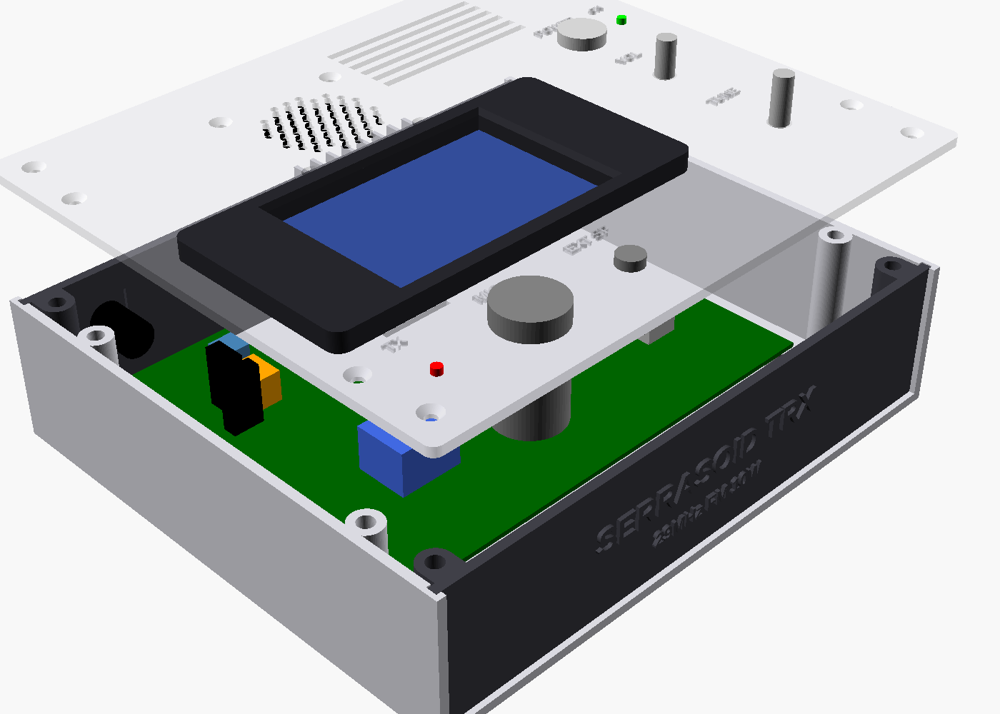
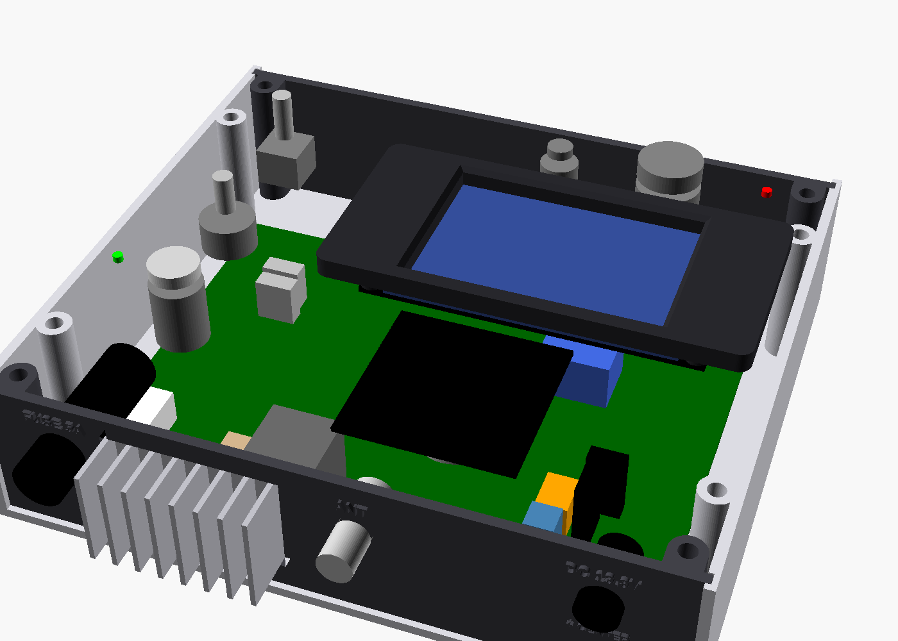
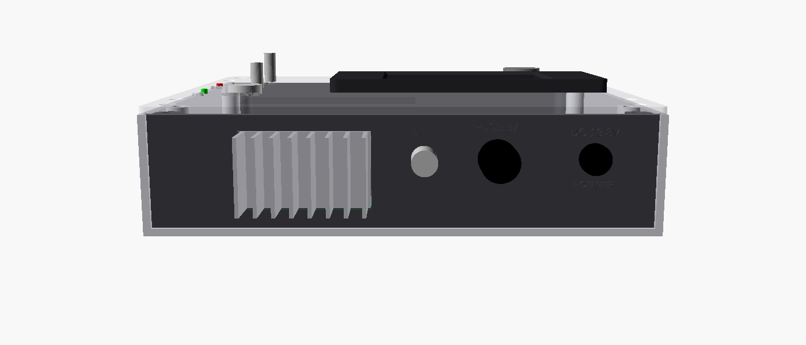
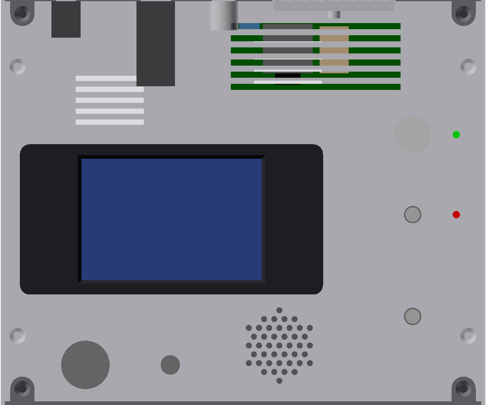

# Serrasoid TRX 29M ケース（OpenSCAD）

`serrasoid_trx_case.scad` は Serrasoid TRX 基板（170 × 130 mm、M3 取付穴 4 か所）を収めるケースのパラメトリックモデルです。PSN_TRX のケース（`PSN_TRX_XIAO_ESP32C3/enclosure/psn_trx_case.scad`）と同じ構成・同じ考え方で作り、終段 RD16HHF1 の放熱器を加えています。





## 構成と外形

| mode | 部品 | 出力ファイル | 印刷の向き・寸法 | 備考 |
|---|---|---|---|---|
| 1 | ベース（底板＋左右側板） | `stl/1_base.stl` | そのまま／200×175×47 mm | 基板スタンドオフ 5 mm（インサート下穴 φ5）、ふた固定ボス 4 本、パネル差し込み溝、パネル一体ボス用の皿穴 4 か所（底面）、底面通風（RD06HHF1・HS1 の下とレギュレータの下）、ゴム足座ぐり |
| 2 | ふた | `stl/2_lid.stl` | 外面を上／200×175×4.2 mm | LCD 切り欠き・TUNE・VOL・POWER・電源 LED・TX LED・MIC・EXT SP ジャック・**内蔵スピーカーの放音穴（φ2.5、直径 35 mm の範囲に六角配置）と取付穴 4 か所（M3 皿もみ、40 mm 角）**（EXT SP の周り 15×15 mm はふた裏から掘って板厚 1.8 mm）、終段の上（X 108〜165、Y 133.5〜161 mm、スピーカーの右）に通風スロット 6 本。M3×10 × 8 本で固定 |
| 3 | 前面パネル | `stl/3_front_panel.stl` | 上端を下にして立てる／196.6×14.4×45.1 mm | 機種名のエンボス（1.2 mm）、内面にボス 2 本一体 |
| 4 | 後面パネル | `stl/4_rear_panel.stl` | 上端を下にして立てる／196.6×14.4×45.1 mm | DC ジャック（周り 15×15 mm を内側から掘って板厚 1.8 mm）・ヒューズホルダ・BNC の穴と**放熱器の窓**、エンボス表示、内面にボス 2 本一体 |
| 9 | LCD ベゼル | `stl/9_lcd_bezel.stl` | 表を下（ボスが上）／125×62×10 mm | PSN_TRX と同じ（TJC4832T135 用） |

- 外形: **幅 200 × 奥行き 175 × 高さ 50 mm**（220 mm 角のベッドで印刷可能。ベゼル 6 mm は上面に出る）。板厚は側板・底板・ふた・前後パネルとも 3 mm。
- 基板: 上辺（KiCad の上側。DC 入力・RD16HHF1・ANT）を**後面**に向けて置きます。基板の下面は底から 8 mm（スタンドオフ 5 mm）、上面は 9.6 mm。基板は X 15〜185、Y 37.1〜167.1 mm（前面から測る）。
- 基板上で最も高いのは HS1（RD06HHF1 の放熱器、25 mm）。上端は底から 34.6 mm、ふた裏面は 47 mm です。
- 操作は上から:
  - 右列（X = 170 mm）: 手前から **TUNE（エンコーダ）・VOL・POWER（＋電源 LED）**、VOL の右に **TX** ランプ
  - 左: LCD ベゼル（中心 X 70.5、Y 71 mm）
  - 手前: **MIC（X 35）・EXT SP ジャック（X 70）**
  - LCD の奥: **内蔵スピーカー（X 80、Y 130）**、その右に通風スロット（PSN_TRX と同じ並び）
  - 後面（後ろから見て右から）: **DC 13.8V・ANT（BNC）・放熱器のフィン・FUSE 5A**（ヒューズは電源スイッチの側。スピーカーのコーンをよけるため右端）
  - 前面: 機種名 `SERRASOID TRX` / `29MHz FM 10W` のみ
- 前後パネルは溝に上から差し込み、内面のボス（左右の側板の近く、X 9 と 191 mm）の上端をふたに、下端を底板にねじ止めします。穴あけ図は `drawings/7_front_panel_2d.dxf/.svg`・`drawings/8_rear_panel_2d.dxf/.svg`（後面は後ろから見た向き、原寸 mm）。
- ねじとインサート（PSN_TRX と同じ）:
  - 基板固定: **M3×6** × 4 本
  - ふた固定: **M3×10** × 8 本（うち 4 本は前後パネル一体のボスに入る）
  - 前後パネル → 底板: **M3×10 皿ねじ** × 4 本（底板の裏から）
  - LCD → ベゼル: **M3×6** × 4 本、ベゼル → ふた: **M3×8** × 4 本（ふた裏から）
  - スピーカー → ふた: **M3×8 皿ねじ** × 4 本＋ **M3 ナット** × 4 個（ふたの上面から差し、スピーカーの枠の裏でナット留め。PSN_TRX と同じ）
  - **RD16HHF1 → 放熱器: M3×8 ＋ナット × 1 本**（放熱器のベースに φ3.2 の穴をあける）

## 終段の放熱

RD16HHF1 は 10W FM で送信している間、約 8W を連続して発熱します。基板の上辺に縦に立てた RD16HHF1（Q3）のタブを、**ケースの内側に立てた市販の押し出しアルミ放熱器のベース面に直接ねじ止め**し、フィンは**後面パネルの長方形の窓から外へ出します**。RD16HHF1 のタブはソース（GND）なので、絶縁シートは不要です（熱伝導グリスは塗る）。



| 項目 | 値（モデルの仮の寸法） |
|---|---|
| 放熱器 | 幅 50（X）× 高さ 30（Z）mm、ベース厚 4 mm、ベースから先のフィン 18 mm |
| 熱抵抗 | **8℃/W 以下、できれば 5℃/W 程度**（約 8W の発熱で温度上昇 40〜64℃） |
| 位置 | ベースの後ろ面が後面パネルの内面（Y 170 mm）に当たる。ベース面（RD16HHF1 側）は Y 166 mm。中心 X 137.5 mm（RD16HHF1 のタブの中心）、下端は底から 10.1 mm（基板上面より 0.5 mm 上） |
| 後面の窓 | X 112.0〜163.0 mm、高さ 9.9〜40.6 mm（底から）。フィンは後面から約 15 mm 外に出る。放熱器の重さは窓の下の縁で受ける |
| RD16HHF1 の取付穴 | 基板上面から 16 mm（底から 25.6 mm）と仮定 |

- 基板の上辺からタブの裏面までは 1.1 mm なので、放熱器のベースが基板の端に 1.1 mm かかります。この範囲には RD16HHF1 以外の部品がないことをモデルで確認しています。
- 放熱器の高さは、ふた裏（47 mm）との隙間が 1 mm 以上になる範囲で変えられます（`hs_h`）。幅を変えると窓も自動で変わります（`hs_w`）。
- ふたの通風スロットは放熱器・RD06HHF1（HS1）・トランス T1 の上にあります。送信を長く続ける場合は、後面の窓のまわりの温度を確かめてください。

## 上面



| 部品 | 穴径 | 接続先 |
|---|---|---|
| LCD（TJC4832T135、3.5 インチ） | 102.5 × 57 mm の切り欠きとベゼル固定穴 φ3.4 × 4 | J3 |
| ロータリーエンコーダ（押しスイッチ付き） | φ7.2 | J4 |
| AF ボリューム（10 kΩ A） | φ7.2 | J8 |
| 電源スイッチ | φ13.0 | DC ジャック → ヒューズ → スイッチ → J1 |
| 電源 LED（3 mm） | φ3.1 | スイッチ後の 13.8V から抵抗経由 |
| TX ランプ（3 mm LED） | φ3.0 | J7 |
| マイクコネクタ（4P 丸型） | φ16.2 | J5（MIC・PTT・GND） |
| 内蔵スピーカー（秋月 116024 DXYD50N-22Z-8A-F、5 cm 8 Ω 0.5 W） | 放音穴 φ2.5（直径 35 mm の範囲、4.5 mm ピッチ）、取付穴 φ3.4 × 4（40 mm 角、皿もみ）。中心 X 80、Y 130 mm（LCD の奥、通風スロットの左） | J9 から EXT SP ジャックのブレーク接点経由 |
| 外部スピーカージャック（3.5 mm、スイッチ付き。秋月 117359 MJ-352W-C） | φ6.2（ジャックの M6 ねじを通しナットで固定。周り 15×15 mm はふた裏から座ぐりして板厚 1.8 mm） | J9。プラグを挿すと内蔵スピーカーが切れる |

エンボス表示: `TUNE`、`VOL`、`POWER`、`ON`、`TX`、`MIC`、`EXT SP`

### 内蔵スピーカー

PSN_TRX の最終版（0685f03）と同じスピーカー・同じ取付方法・同じ位置（LCD の奥、通風スロットの左）です。

- 秋月 116024（5 cm 角、8 Ω 0.5 W）を、枠をふた裏に密着させ、四隅の穴（40 mm 角）にふたの上から **M3×8 皿ねじ** を差して枠の裏で **ナット** 留めします。別の押さえ部品はありません。
- 配線: 基板 J9（SPK・GND）→ EXT SP ジャック（MJ-352W-C）のブレーク接点 → 内蔵スピーカー。外部スピーカーを挿すと内蔵が切れます。基板の変更はありません。
- マグネット（φ22）の下端は底から 29.5 mm。真下の基板の部品（高さ 11 mm 以下の一般の部品）とは 8 mm 以上あきます（モデルで確認）。
- TX ランプは PSN_TRX の最終版では MIC の左へ移しましたが、Serrasoid では MIC が左の側板に近い（X 35）ので、これまでどおり VOL の右に置いています。

## 後面パネル

| 部品 | 穴径 | 備考 |
|---|---|---|
| DC ジャック（パネル取付、2.1/2.5 mm） | φ8.0 | センタープラス |
| ヒューズホルダ（5 × 20 mm、パネル取付） | φ12.5 | **5A**。本体はパネルの裏に約 35 mm 出る。右端（X 176、電源スイッチの奥）に置き、リレー K1 の上（高さ 30 mm）を通す |
| BNC（アンテナ） | φ9.6 | 基板 J6 へ RG-174 で接続 |
| 放熱器の窓 | 51 × 30.7 mm | 上の「終段の放熱」 |

DC・ヒューズ・BNC の中心は底から 30 mm。エンボス表示: `DC 13.8V`、`+ CENTER`、`FUSE 5A`、`ANT`

## モデルでの確認（assert）

レンダリングのたびに次を確認し、当たるときはエラーで止まります。

- 上面の部品（エンコーダ・VOL・電源スイッチ・MIC・EXT SP・LED・LCD・内蔵スピーカー）のふた裏の本体が、基板の部品に当たらないこと（基板上の背の高い部品 13 点の位置と高さは `tall` の表、ほかの部品は高さ 11 mm とみなす）
- つまみ・文字・ベゼルどうしの隙間、ふた固定ねじ頭との距離
- 後面の部品の本体が基板の部品に当たらないこと、放熱器の窓・底板・ふたにかからないこと
- 放熱器がふたに当たらないこと、RD16HHF1 の取付穴が放熱器の範囲に入ること
- ボスが基板・放熱器・後面の部品にかからないこと

## 注意（必ず実測してから出力）

- **放熱器**: 実際に使う放熱器の幅・高さ・ベース厚・フィンの長さを `hs_w`・`hs_h`・`hs_base`・`hs_fin` に入れてください。ベース厚が変わると基板の前後位置（`by_rear`）も自動で変わります。
- **RD16HHF1 の取付穴の高さ**（`q6_hole_h`、基板上面から 16 mm と仮定）: 実装したときのリードの長さで変わります。放熱器の穴は、実装してから現物合わせであけるのが確実です。
- **内蔵スピーカー**: 寸法（外形 50 mm 角・取付穴 40 mm 角・奥行き 17.5 mm・マグネット φ22）は PSN_TRX と同じ値です。実物で確かめてください。
- **LCD**: 寸法は PSN_TRX のケースと同じ推定値です（`lcd_win_off`・`lcd_holes`・`lcd_boss_h` は要実測）。
- コネクタ・スイッチ類の穴径とパネル裏の長さは、ファイル先頭のパラメータを実部品に合わせて直してください。

## 出力方法（mode 番号）

| mode | 内容 |
|---|---|
| 0 | 組立図（ふたを浮かせて表示） |
| 1 | ベース（3D 印刷用） |
| 2 | ふた（3D 印刷用） |
| 3 | 前面パネル（3D 印刷用） |
| 4 | 後面パネル（3D 印刷用） |
| 5 | 組立図（ふたを閉じた状態） |
| 6 | ふたなし内部 |
| 7 | 前面パネル穴あけ図（2D：DXF/SVG） |
| 8 | 後面パネル穴あけ図（2D：DXF/SVG） |
| 9 | LCD ベゼル（3D 印刷用） |

```sh
openscad -o stl/1_base.stl         -D mode=1 serrasoid_trx_case.scad
openscad -o stl/2_lid.stl          -D mode=2 serrasoid_trx_case.scad
openscad -o stl/3_front_panel.stl  -D mode=3 serrasoid_trx_case.scad
openscad -o stl/4_rear_panel.stl   -D mode=4 serrasoid_trx_case.scad
openscad -o stl/9_lcd_bezel.stl    -D mode=9 serrasoid_trx_case.scad
openscad -o drawings/7_front_panel_2d.dxf -D mode=7 serrasoid_trx_case.scad
openscad -o drawings/8_rear_panel_2d.dxf  -D mode=8 serrasoid_trx_case.scad
```
