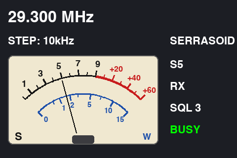
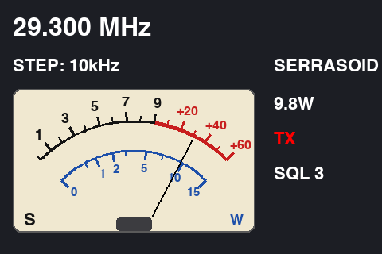
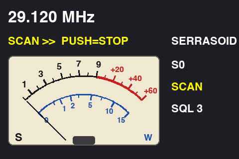

# LCD 画面データ（.HMI）の作成手順（Nextion NX4832T035 / TJC4832T135）

Serrasoid TRX の LCD（標準は Nextion NX4832T035、3.5 インチ 480 × 320。PSN_TRX と同じ品。**TJC4832T135 でも使えます**）に書き込む画面データの作り方です。PSN_TRX の手順（`PSN_TRX_XIAO_ESP32C3/nextion/画面データ作成手順.md`）と同じ作り方で、背景画像と部品の配置だけが違います。

スケッチ（`../Serrasoid_TRX.ino`）は LCD に `t0.txt="…"`（文字）・`picq`（メーターの描き直し）・`line`（針）を送るだけなので、画面データには **背景画像 1 枚と、テキスト部品 t0〜t6** があれば足ります（ボタンやスクリプトは不要）。XIAO から LCD への一方向の通信なので、タッチ操作は使いません。

画面データ（.HMI / .tft）はまだ作っていません。下の手順で作り、できた .HMI と .tft をこのフォルダに置いてください。

## 表示の見本

| 受信中 | 送信中 | スキャン中 |
|---|---|---|
|  |  |  |

| 部品 | 表示 | 内容 |
|---|---|---|
| t0 | `29.300 MHz` | 周波数（29.000〜29.700MHz） |
| t1 | `STEP: 10kHz` | ダイヤルのステップ。設定モード中は `MENU > SQL`・`> SQL 3  [PUSH=OK]`、スキャン中は `SCAN >>  PUSH=STOP`（止まっているときは `SCAN: BUSY`） |
| t2 | `SERRASOID` | 固定表示（スケッチの `FIXED_TEXT`） |
| メーター | 針 | 受信中 = 外側の **S メーター**（S0〜S9、+10〜+60dB は赤。PSN_TRX と同じ目盛り）、送信中 = 内側の **出力 W**（青） |
| t3 | `S5` / `9.8W` | メーターの値 |
| t4 | `RX` / `TX` / `SCAN` | 受信（白）・送信（赤）・スキャン（黄） |
| t5 | `SQL 3` / `SQL OFF` | スケルチの深さ |
| t6 | `BUSY` | スケルチが開いている（信号がある）とき緑で表示 |

- **S メーター**: この機械には受信電界強度（RSSI）の線がないので、S はスケルチ用ノイズ（XIAO の D2）の減り方（FM のクワイティング）から計算した目安です。無信号を S0、ノイズが消えきったところを `QUIET_RANGE_DB`（既定 30dB = S5）とし、それより強い信号では S5 から上へは振れません。S9 以上まで正しく振らせるには、RSSI 出力のある IF IC（MC3371 など）に替える回路の変更が必要です。
- **出力 W** は出力検出（D1、容量分割 ＋ 1N60）の電圧から計算した目安です。検波電圧は振幅に比例するので、目盛りは √W の位置に打ってあります。
- 換算の値は実機で合わせます（スケッチの `NOISE_NOSIG_MV`・`NOISE_FULL_MV`・`QUIET_RANGE_DB`・`FWD_MV_10W`。シリアルモニタ 115200bps に生の値が出ます）。

## 使うエディタと機種

| LCD | エディタ | 機種の選択 |
|---|---|---|
| **Nextion NX4832T035**（Basic、本機の標準） | Nextion Editor | NX4832T035_011 |
| Nextion NX4832F035（Discovery、代わりに使える） | Nextion Editor | NX4832F035_011 |
| **TJC4832T135**（代わりに使える。AliExpress の TJC 公式ストアなど） | USART HMI（淘晶驰の公式エディタ） | TJC4832T135_011（裏のシールの型番） |

- 機種名は LCD の裏のシールで確かめてください（末尾 `_011` は抵抗膜タッチ付き、`_010` はタッチなし。どちらでもかまいません）。
- **TJC を使う場合**: スケッチはそのまま使えます（送る命令・色の値・`baud=` は Nextion と同じ）。違うのは画面データだけで、Nextion と TJC は見た目が同じでもエディタと画面データ（.HMI / .tft）に互換性がありません。TJC は **USART HMI** で、下の 1〜7 章と同じ内容（背景画像・フォント 2 つ・t0〜t6 の配置と属性）を作ります。メニューの名前は中国語表示のことがありますが、属性名（sta・picc・pco・xcen・ycen・isbr・txt_maxl）は同じです。フォントは USART HMI の「字库生成」（フォント作成）で作ります（Nextion 用の .zi は使えません）。
- TJC の .tft は TJC にだけ、Nextion の .tft は Nextion にだけ書き込めます。両方作る場合は、`Serrasoid_TRX_nextion.HMI`・`Serrasoid_TRX_tjc.HMI` のように名前を分けてこのフォルダに置いてください。

---

## 1. 新しいプロジェクトを作る

1. エディタを起動し、**File → New** で保存先とファイル名（例: `Serrasoid_TRX.HMI`）を決めます。
2. 機種の選択画面で、上の表の機種を選びます。
3. **Display**（表示方向）で **横向き 90°**（Horizontal / 90）を選び、**480 × 320** になっていることを確かめます。
4. **Character encoding** は `iso-8859-1` でかまいません（表示する文字は半角英数字だけです）。

## 2. 背景画像（ピクチャ 0）を取り込む

1. 左下の **Picture** 欄の **+** を押し、このフォルダの [`background.png`](background.png)（480 × 320）を選びます。
2. 番号 **0** として登録されたことを確かめます（スケッチの `picq …,0` がピクチャ 0 を使います）。

> 背景画像を作り直すときは `python3 make_background.py`（Pillow が必要）。目盛りの位置はスケッチの `METER_*`・`PWR_FULL` と同じ値になっています。見本の画像（preview_*.png）も同時にできます。

## 3. フォントを作る（2 種類）

**Tools → Font Generator** で、次の 2 つを作ってプロジェクトに追加します。**追加した順に フォント 0・フォント 1 になる**ので、必ず 24 ドットを先に追加します。PSN_TRX の `consolas24.zi`・`consolas32.zi` をそのまま使ってもかまいません（Fonts 欄の **+** で 24 → 32 の順に追加）。

| 番号 | 高さ | 文字の範囲 | 用途 |
|---|---|---|---|
| 0 | 24 | 半角英数字（ASCII） | t1〜t6 |
| 1 | 32 | 半角英数字（ASCII） | t0（周波数） |

## 4. page0 の背景を設定する

page0 を選び（何もない所をクリック）、属性欄で **sta = image**、**pic = 0** にします。メーターの目盛りが表示されれば OK です。

## 5. テキスト部品 t0〜t6 を置く

ツールボックスの **Text** を 7 回押して部品を 7 個置き、それぞれ次のとおりにします。**部品の名前（objname）がスケッチと一致していることが一番大事**です（t0 から順に置くと名前が合います）。

| objname | x | y | w | h | font | xcen（横寄せ） | txt_maxl | 表示する内容 |
|---|---|---|---|---|---|---|---|---|
| t0 | 16 | 16 | 448 | 40 | **1** | 0（左） | 16 | 周波数 |
| t1 | 16 | 68 | 320 | 32 | 0 | 0（左） | 32 | ステップ・メニュー・スキャン |
| t2 | 344 | 68 | 120 | 32 | 0 | 0（左） | 12 | 固定表示 |
| t3 | 344 | 116 | 120 | 32 | 0 | 0（左） | 10 | メーターの値 |
| t4 | 344 | 160 | 120 | 32 | 0 | 0（左） | 6 | RX / TX / SCAN |
| t5 | 344 | 204 | 120 | 32 | 0 | 0（左） | 8 | スケルチの深さ |
| t6 | 344 | 248 | 120 | 32 | 0 | 0（左） | 6 | BUSY |

7 個とも共通で、次の属性も変えます。

| 属性 | 値 | 理由 |
|---|---|---|
| sta | **crop image** | 文字の後ろに背景画像をそのまま見せる |
| picc | **0** | 切り抜く背景 = ピクチャ 0 |
| pco | **65535**（白） | 文字の色（t4 の赤 63488・黄 65504、t6 の緑 2016 はスケッチが変える） |
| ycen | 1（中央） | 縦方向は枠の中央 |
| isbr | **False** | 折り返さない |
| txt | **空にする** | 初期値の `newtxt` を消す。表示はスケッチが送る |

- sta を crop image にしない場合は、sta = solid color・**bco = 6372**（背景画像の地の色と同じ）にします。
- **メーター面（x 16〜320、y 112〜292）には部品を置かないでください。** スケッチが針を描くとき、この範囲を背景画像で描き直します。
- t1 は スキャン中の `SCAN >>  PUSH=STOP` まで入る幅にしてあります。文字が切れるときはフォント 0 の書体を細めにします。

## 6. シミュレータで確かめる

1. **Compile** を押し、エラーがないことを確かめます。
2. **Debug** を押すとシミュレータが開きます。
3. 左下の **Instruction Input Area** に、次の行を貼り付けて Enter を押します（末尾の `FF FF FF` は入力不要）。

```
t0.txt="29.300 MHz"
t1.txt="STEP: 10kHz"
t2.txt="SERRASOID"
t3.txt="S5"
t4.txt="RX"
t5.txt="SQL 3"
t6.pco=2016
t6.txt="BUSY"
picq 16,112,305,181,0
line 156,270,127,164,0
line 157,270,128,164,0
```

文字が見本と同じ位置に出て、メーターの S5 付近に針が描かれれば OK です。送信中とスキャン中の表示は次で確かめられます。

```
t3.txt="9.8W"
t4.pco=63488
t4.txt="TX"
t6.txt=""
picq 16,112,305,181,0
line 191,274,242,177,0
line 192,274,243,177,0
```

```
t0.txt="29.120 MHz"
t1.txt="SCAN >>  PUSH=STOP"
t3.txt="S0"
t4.pco=65504
t4.txt="SCAN"
```

## 7. LCD に書き込む

1. **File → TFT file output**（TJC の USART HMI では「输出生产文件」）で、`Serrasoid_TRX.tft` を作ります。
2. 書き込みは次のどちらかです。
   - **microSD カード**: FAT32 でフォーマットした microSD のルートに .tft を 1 つだけ入れ、LCD の電源を切って差し、電源を入れると書き込みが始まります。終わったら電源を切ってカードを抜きます。
   - **USB シリアル変換**: エディタの **Upload** で、USB シリアル変換（5V、TX・RX・GND）を LCD の 4 ピンにつないで書き込みます。

## 8. 基板とのつなぎ

- 基板の J3（LCD、4 ピン）: 1 = +5V、2 = XIAO の TX（D6）、3 = 空き、4 = GND。
- Nextion・TJC の付属ケーブルは 赤 = +5V、青 = TX、黄 = RX、黒 = GND（TJC も同じ並び。念のため LCD の基板の印字 5V・TX・RX・GND で確かめる）。**J3 の 2 番を黄（LCD の RX）に**つなぎます。青（LCD の TX）はつながず、絶縁しておきます。
- 起動時、スケッチは 9600bps で `baud=115200` を送ってから 115200bps に切り替えます（LCD には保存しないので、電源を入れ直すと 9600bps に戻ります）。
