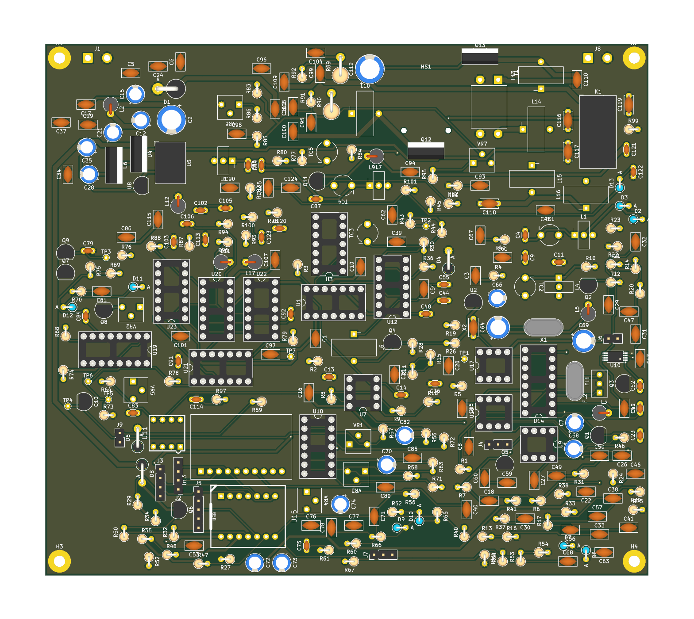
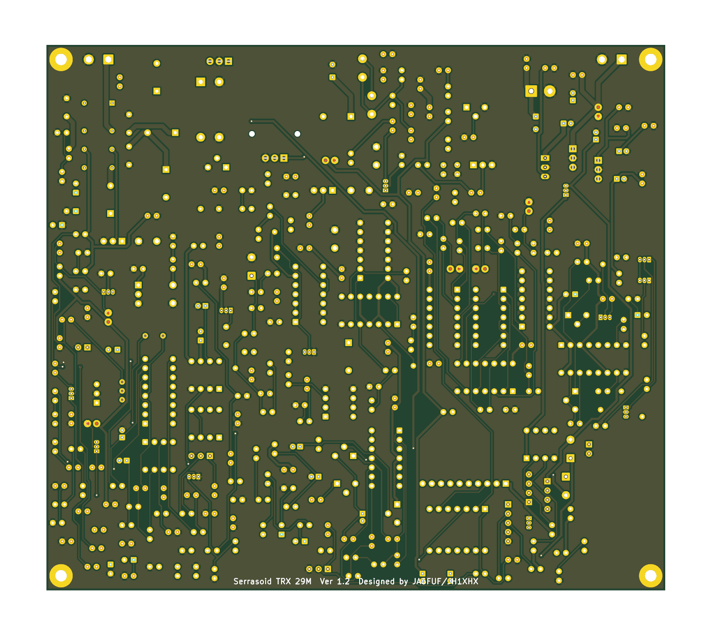

# 基板の発注資料（Serrasoid TRX 29M 基板 Ver 1.2）

- 出力日: 2026-10-29
- 元データ: `kicad/Serrasoid_TRX.kicad_pcb`（DRC エラー 0・未接続 0・回路図との食い違い 0。警告はシルクの重なりなどのみ）
- 出力: KiCad 10 の kicad-cli（ガーバー X2、ドリルは Excellon・mm・スルーホールとノンスルーを別ファイル）。シルクはソルダーマスクの開口で切り取り（`--subtract-soldermask`）

## 発注するファイル

**[Serrasoid_TRX_Gerber_JLCPCB.zip](Serrasoid_TRX_Gerber_JLCPCB.zip) だけをアップロード**してください（14 ファイル）。

| ファイル | 内容 |
|---|---|
| Serrasoid_TRX-F_Cu.gtl | 表（部品面）の銅箔（L1） |
| Serrasoid_TRX-In1_Cu.g1 | 内層 1（GND ベタ、L2） |
| Serrasoid_TRX-In2_Cu.g2 | 内層 2（GND ベタ、L3） |
| Serrasoid_TRX-B_Cu.gbl | 裏の銅箔（L4） |
| Serrasoid_TRX-F_Mask.gts / B_Mask.gbs | ソルダーマスク（表・裏） |
| Serrasoid_TRX-F_Paste.gtp / B_Paste.gbp | メタルマスク（表は NJM2594V の 8 パッドだけ。裏はなし） |
| Serrasoid_TRX-F_Silkscreen.gto / B_Silkscreen.gbo | シルク（表・裏） |
| Serrasoid_TRX-Edge_Cuts.gm1 | 外形 |
| Serrasoid_TRX-PTH.drl | スルーホール 889 穴（φ0.4〜3.2mm、うちビア 18 個 φ0.4） |
| Serrasoid_TRX-NPTH.drl | ノンスルー 2 穴（φ1.6mm） |
| Serrasoid_TRX-job.gbrjob | ジョブファイル（層の並び・板厚） |

`gerbers/` には同じファイルと、ドリルの位置図（`*-drl_map.gbr`、確認用。ZIP には入れていない）があります。

## 発注のときの指定

| 項目 | 値 |
|---|---|
| 層数 | **4 層**（L1 表、L2・L3 内層 GND、L4 裏） |
| 外形 | **170 × 150mm** |
| 板厚 | 1.6mm |
| 最小穴径 | 0.4mm（ビア）。部品の穴は 0.7mm 以上 |
| 最小線幅 | 0.3mm |
| 最小間隔 | 0.25mm 程度（配線の設定）。DRC で違反なし |
| ビア | 18 個、穴 0.4mm・径 0.8mm（貫通ビアのみ） |
| 銅箔厚 | 外層 1oz（終段まわりの太い線は 1.2mm 幅で 3A を想定） |
| 表面処理 | 指定なし（HASL で可。手はんだ） |
| レジスト色 | 任意 |
| 部品実装 | **頼まない**（部品はリード部品で手はんだ。表面実装は NJM2594V の 1 点だけで、これも手はんだ） |

上の値は一般的な基板メーカーの標準仕様の範囲です。外形が 100mm を超えるので、料金は「100 × 100mm 以下」の格安枠より高くなります。

## 確認用の画像

| 部品面 | はんだ面 |
|---|---|
|  |  |

（KiCad の 3D 表示。放熱器 HS1 など 3D モデルのない部品は表示されない）

## 出し直し方

```sh
K=/Applications/KiCad/KiCad.app/Contents/MacOS/kicad-cli
O=kicad/production/gerbers
$K pcb export gerbers --layers F.Cu,In1.Cu,In2.Cu,B.Cu,F.Mask,B.Mask,F.Paste,B.Paste,F.Silkscreen,B.Silkscreen,Edge.Cuts \
   --subtract-soldermask --use-drill-file-origin -o $O/ kicad/Serrasoid_TRX.kicad_pcb
$K pcb export drill --format excellon --excellon-separate-th --excellon-units mm --generate-map --map-format gerberx2 \
   -o $O/ kicad/Serrasoid_TRX.kicad_pcb
# 内層は KiCad 上の名前が GND1・GND2 なので、ファイル名を In1_Cu・In2_Cu にそろえる（ジョブファイルの中も）
mv $O/Serrasoid_TRX-GND1.g1 $O/Serrasoid_TRX-In1_Cu.g1
mv $O/Serrasoid_TRX-GND2.g2 $O/Serrasoid_TRX-In2_Cu.g2
sed -i '' 's/Serrasoid_TRX-GND1\.g1/Serrasoid_TRX-In1_Cu.g1/; s/Serrasoid_TRX-GND2\.g2/Serrasoid_TRX-In2_Cu.g2/' $O/Serrasoid_TRX-job.gbrjob
(cd $O && zip ../Serrasoid_TRX_Gerber_JLCPCB.zip $(ls | grep -v drl_map))
```

基板を直したら、DRC（エラー 0・未接続 0）を確かめてから出し直してください。
